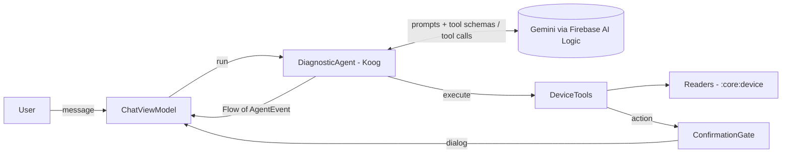
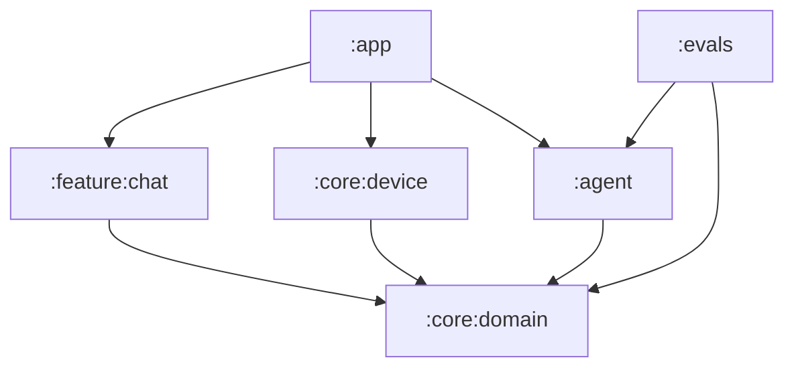

# Architecture — Device Doctor v0

> Code samples using Koog / Firebase AI Logic are **illustrative**. Verify every signature against the
> current docs (Koog 1.x, Firebase AI Logic) before implementing.

## 1. Scope

**v0 does:** chat with an agent that diagnoses battery, storage, performance, network/data issues by
reading device state through tools, explains its reasoning (live trace), and proposes actions that open
the relevant system settings after user confirmation.

**v0 does NOT:** kill apps, clear other apps' caches, change system settings itself (not possible without
root/device owner anyway), run in background, keep long-term memory across sessions.

## 2. Big picture



Who does what:
- **LLM (remote):** decides which tool to call next and writes the final answer. Never touches the device.
- **Koog (on device):** runs the loop, converts tools to schemas, executes tool calls, keeps history,
  enforces limits, emits events.
- **DeviceTools (on device):** thin adapters from tool calls to domain readers. Validation lives here.
- **Readers (on device):** Android APIs. Return domain snapshots. No AI knowledge.

## 3. Modules



## 4. Domain (`:core:domain`, pure Kotlin)

### Snapshots
```kotlin
@Serializable data class BatterySnapshot(
    val levelPercent: Int,
    val isCharging: Boolean,
    val temperatureC: Float,
    val health: String,                 // GOOD, OVERHEAT, ...
    val drainPercentPerHour: Float?,    // null if not enough history
    val historyHours: Float,            // how much history the drain is based on
)

@Serializable data class StorageSnapshot(val totalGb: Float, val freeGb: Float, val freePercent: Int)

@Serializable data class AppUsage(
    val packageName: String,
    val label: String,
    val foregroundMinutes: Int,
    val foregroundServiceMinutes: Int?, // API 29+
    val lastUsed: Instant?,
)

@Serializable data class AppDetails(
    val packageName: String,
    val label: String,
    val versionName: String?,
    val lastUpdated: Instant,
    val installedFrom: String?,
    val sensitivePermissionsGranted: List<String>, // location (incl. background), camera, mic, etc.
    val appSizeMb: Float?,
    val dataSizeMb: Float?,
    val cacheSizeMb: Float?,
)

@Serializable data class AppSize(val packageName: String, val label: String, val totalMb: Float)
@Serializable data class AppDataUsage(val packageName: String, val label: String, val mobileMb: Float, val wifiMb: Float)

@Serializable data class NetworkSnapshot(
    val type: String,                   // WIFI, CELLULAR, NONE
    val isMetered: Boolean,
    val isValidated: Boolean,           // internet actually reachable
    val downstreamKbps: Int?,
    val upstreamKbps: Int?,
)
```

### Reader interfaces (implemented in `:core:device`, faked in tests/evals)
```kotlin
interface BatteryReader   { suspend fun snapshot(): BatterySnapshot }
interface StorageReader   { suspend fun snapshot(): StorageSnapshot; suspend fun topAppsBySize(limit: Int): ReaderResult<List<AppSize>> }
interface UsageReader     { suspend fun topApps(hours: Int, limit: Int): ReaderResult<List<AppUsage>> }
interface AppInfoReader   { suspend fun details(packageName: String): ReaderResult<AppDetails> }
interface NetworkReader   { suspend fun snapshot(): NetworkSnapshot; suspend fun topDataUsage(days: Int, limit: Int): ReaderResult<List<AppDataUsage>> }
interface SettingsNavigator { fun openAppSettings(packageName: String); fun openBatterySettings(); fun openStorageSettings() }

sealed interface ReaderResult<out T> {
    data class Ok<T>(val value: T) : ReaderResult<T>
    data class PermissionMissing(val permission: String) : ReaderResult<Nothing>
    data class NotFound(val what: String) : ReaderResult<Nothing>
}
```

### ConfirmationGate (human-in-the-loop)
```kotlin
data class ConfirmationRequest(val id: String, val title: String, val reason: String)

class ConfirmationGate(private val timeout: Duration = 60.seconds) {
    private val _pending = MutableStateFlow<Pair<ConfirmationRequest, CompletableDeferred<Boolean>>?>(null)
    val pending: StateFlow<ConfirmationRequest?> = _pending.map { it?.first }.stateIn(/* scope injected */)

    suspend fun ask(request: ConfirmationRequest): Boolean {
        val answer = CompletableDeferred<Boolean>()
        _pending.value = request to answer
        return try { withTimeoutOrNull(timeout) { answer.await() } ?: false }
        finally { _pending.value = null }
    }

    /** Ignored unless [requestId] is the pending request, so a late tap cannot answer a newer one. */
    fun respond(requestId: String, accepted: Boolean) { /* complete only when the ids match */ }
}
```
(Exact StateFlow wiring is an implementation detail; behaviour to test: ask suspends until respond,
timeout ⇒ false, cancellation clears pending, a stale id is ignored.)

### Agent events (for trace UI, logs, evals)
```kotlin
sealed interface AgentEvent {
    val at: Instant
    data class RunStarted(override val at: Instant, val runId: String, val model: String, val promptVersion: String) : AgentEvent
    data class LlmCallFinished(override val at: Instant, val durationMs: Long, val inputTokens: Int?, val outputTokens: Int?) : AgentEvent
    data class ToolCallStarted(override val at: Instant, val tool: String, val argsJson: String) : AgentEvent
    data class ToolCallFinished(override val at: Instant, val tool: String, val resultJson: String, val durationMs: Long) : AgentEvent
    data class ToolCallFailed(override val at: Instant, val tool: String, val error: String) : AgentEvent
    data class ConfirmationAsked(override val at: Instant, val request: ConfirmationRequest) : AgentEvent
    data class FinalAnswer(override val at: Instant, val text: String) : AgentEvent
    data class RunFailed(override val at: Instant, val reason: String) : AgentEvent   // limit reached, timeout, network...
}

interface DiagnosticAgent {
    /** Cold flow: one run per collection. Emits events, ends with FinalAnswer or RunFailed. */
    fun run(userMessage: String, history: List<ChatTurn>): Flow<AgentEvent>
}
```

## 5. Device layer (`:core:device`)

| Reader | Android API | Permission / constraint |
|---|---|---|
| Battery | `ACTION_BATTERY_CHANGED` sticky intent, `BatteryManager` | none |
| Battery drain | `BatterySamplerWorker` (WorkManager, every 15 min) → Room `battery_samples` | none; drain computed from last ≤ 6 h; `null` if < 1 h of history |
| Storage | `StatFs`, `StorageStatsManager.queryStatsForPackage` | per-app sizes need **Usage access** |
| Usage | `UsageStatsManager.queryAndAggregateUsageStats` | **Usage access** (`PACKAGE_USAGE_STATS`, special access via `Settings.ACTION_USAGE_ACCESS_SETTINGS`, check with `AppOpsManager`) |
| App details | `PackageManager.getPackageInfo` (+ requested/granted permissions) | package visibility via `<queries>` launcher intent — **no `QUERY_ALL_PACKAGES`** |
| Network | `ConnectivityManager.getNetworkCapabilities` | `ACCESS_NETWORK_STATE` |
| Data usage | `NetworkStatsManager.querySummary` | **Usage access** |
| Navigation | `ACTION_APPLICATION_DETAILS_SETTINGS`, battery/storage settings intents | none |

Honest limits to document in README + system prompt:
- **No per-app battery consumption API** for third-party apps. The agent infers suspects from usage time,
  foreground service time, background location permission, recent updates — and must say it's an inference.
- Battery drain needs history: just after install, `drainPercentPerHour = null` ⇒ the agent must say so.

## 6. Agent (`:agent`)

### Tools (one `ToolSet`, thin adapters over readers)

| Tool | Args (coerced) | Kind |
|---|---|---|
| `getBatteryInfo()` | – | read |
| `getStorageInfo()` | – | read |
| `getTopAppsBySize(limit)` | limit 1..10 | read |
| `getTopAppsByUsage(hours, limit)` | hours 1..72, limit 1..10 | read |
| `getAppDetails(packageName)` | must match `^[a-zA-Z0-9_.]+$` | read |
| `getNetworkInfo()` | – | read |
| `getTopDataUsage(days, limit)` | days 1..30, limit 1..10 | read |
| `openAppSettings(packageName, reason)` | same regex; reason ≤ 200 chars | **action → ConfirmationGate** |
| `openBatterySettings(reason)` / `openStorageSettings(reason)` | reason ≤ 200 chars | **action → ConfirmationGate** |

```kotlin
@LLMDescription("Tools to inspect the state of this Android phone and open system settings")
class DeviceTools(
    private val battery: BatteryReader,
    private val usage: UsageReader,
    private val apps: AppInfoReader,
    private val gate: ConfirmationGate,
    private val settings: SettingsNavigator,
    private val json: Json,
) : ToolSet {

    @Tool @LLMDescription("Battery level, charging state, temperature, health, and drain rate per hour (null if not enough history)")
    suspend fun getBatteryInfo(): String = json.encodeToString(battery.snapshot())

    @Tool @LLMDescription("Most used apps over the last N hours (1-72): foreground minutes and foreground-service minutes")
    suspend fun getTopAppsByUsage(hours: Int, limit: Int): String =
        usage.topApps(hours.coerceIn(1, 72), limit.coerceIn(1, 10)).toToolJson()

    @Tool @LLMDescription("Opens the system settings page of an app so the USER can act. The user is asked to confirm first.")
    suspend fun openAppSettings(packageName: String, reason: String): String {
        if (!PACKAGE_REGEX.matches(packageName)) return "error: invalid_package"
        val ok = gate.ask(ConfirmationRequest(id = uuid(), title = packageName, reason = reason.take(200)))
        return if (ok) { settings.openAppSettings(packageName); "opened" } else "user_declined"
    }
    // ...
}

private fun <T> ReaderResult<T>.toToolJson(): String = when (this) {
    is ReaderResult.Ok -> json.encodeToString(value)
    is ReaderResult.PermissionMissing -> "error: permission_missing:$permission"
    is ReaderResult.NotFound -> "error: not_found:$what"
}
```

### System prompt (`prompts/diagnostic.md`, versioned)
Key rules (final wording by the human):
- You diagnose problems on THIS Android phone. Use tools to check before concluding.
- Start with the most relevant tool; follow the evidence; stop when you have enough (max ~6 tools).
- Never invent numbers or app names. Quote values from tool results.
- If a tool returns `permission_missing`, explain which access is needed and why.
- If no tool can verify something, say "I can't check that on this phone", then give general advice
  clearly labelled as unverified.
- Distinguish facts (tool results) from inferences ("likely", "probably").
- Propose at most one action; actions only via the open*Settings tools.
- Answer in the user's language, short, with: cause → evidence → suggested action.

### Agent wiring
```kotlin
class KoogDiagnosticAgent(
    private val executorProvider: LlmExecutorProvider,
    private val tools: DeviceTools,
    private val prompt: VersionedPrompt,
    private val clock: Clock,
    private val config: AgentConfig = AgentConfig(maxToolCalls = 8, timeout = 45.seconds),
) : DiagnosticAgent {
    override fun run(userMessage: String, history: List<ChatTurn>): Flow<AgentEvent> = channelFlow {
        val agent = AIAgent(
            promptExecutor = executorProvider.executor(),
            llmModel = executorProvider.model(),
            systemPrompt = prompt.text,
            toolRegistry = ToolRegistry { tools(tools) },
            maxIterations = config.maxIterations,
        ) {
            // Koog event handler feature → map to AgentEvent and send(...)
            // (verify the current API name: EventHandler / handleEvents { onToolCall... })
        }
        send(AgentEvent.RunStarted(...))
        val answer = withTimeoutOrNull(config.timeout) { agent.run(buildInput(userMessage, history)) }
        send(answer?.let { AgentEvent.FinalAnswer(clock.now(), it) } ?: AgentEvent.RunFailed(clock.now(), "timeout"))
    }
}
```
Chat history v0: each user message = one agent run; the last N turns (user + final answers, no tool
traces) are injected as context. Check whether Koog 1.x offers a better session/history mechanism.

### LLM providers — `LlmExecutorProvider`

| Provider | Where | Key handling | Use |
|---|---|---|---|
| **FirebaseAi** (Gemini Developer API via Firebase AI Logic) | Android | none in app; App Check | **default in the app** |
| **GoogleApiKey** (Koog Google executor) | JVM + Android debug | env var / `local.properties` → debug `BuildConfig` only | evals, early dev (Phase 2) |
| **Anthropic** (Koog Anthropic executor) | JVM + Android | env var for evals; **BYOK** in app (Keystore) | Phase 5 comparison |

Model IDs are **config**, never hardcoded in logic (models are retired often).

### `FirebaseAiLLMClient` — Koog ↔ Firebase AI Logic adapter (Phase 3)
Koog's built-in Google client needs an API key. To keep the app keyless and on the free tier with App
Check, implement Koog's `LLMClient` on top of Firebase AI Logic:

```kotlin
class FirebaseAiLLMClient(private val firebaseAi: FirebaseAI) : LLMClient {
    override suspend fun execute(prompt: Prompt, model: LLModel, tools: List<ToolDescriptor>): List<Message.Response> {
        val gm = firebaseAi.generativeModel(
            modelName = model.id,
            tools = listOf(Tool.functionDeclarations(tools.map { it.toFunctionDeclaration() })),
            systemInstruction = prompt.systemText()?.let { content { text(it) } },
        )
        val response = gm.generateContent(*prompt.toFirebaseContents().toTypedArray())
        return response.toKoogResponses()   // TextPart → Assistant, FunctionCallPart → Tool.Call (keep id)
    }
    // executeStreaming / moderate: not supported in v0 → clear UnsupportedOperationException
}
```
Mapping to implement + unit test (pure functions, no network):
- Koog `ToolDescriptor` (params, types, required) → Firebase `FunctionDeclaration` + `Schema`
- Koog messages → Firebase `Content`: user → `role="user"` TextPart; assistant → `role="model"`;
  tool call → `FunctionCallPart`; tool result → `role="function"` `FunctionResponsePart(name, JsonObject, id)`
- Firebase response → Koog `Message.Assistant` / `Message.Tool.Call`, usage metadata → token counts

Do a **spike first** (Phase 3, step 1): print the exact current `LLMClient` interface from Koog 1.x
and the Firebase AI Logic Kotlin types; adjust this design before coding. A community lib may exist
(e.g. "koog-firebase") — evaluate it, but prefer our own small adapter (portfolio value, control).
If the adapter proves too costly: fallback = keep Koog for evals (API key) and document it in an ADR.

## 7. UI (`:feature:chat`)

```
┌───────────────────────────────┐
│ Device Doctor          [⚙]    │
├───────────────────────────────┤
│ 💬 messages                    │
│   user / agent bubbles        │
├───────────────────────────────┤
│ 🔍 Trace (collapsible)         │
│  ✓ getBatteryInfo     120 ms  │  tap ⇒ args + JSON result
│  ✓ getTopAppsByUsage  340 ms  │
│  ⏳ getAppDetails              │
├───────────────────────────────┤
│ [ Describe your problem… ] ➤  │
└───────────────────────────────┘
+ ModalBottomSheet when ConfirmationGate.pending != null  (Accept / Decline)
+ Banner when Usage access is missing (button → settings)
+ Suggested prompts on empty state ("Battery drains fast", "Phone is slow", "Storage full", "Mobile data")
```
`ChatUiState(messages, traceItems, isRunning, pendingConfirmation, missingPermissions, error)`.

## 8. Evals (`:evals`, JVM)

Scenario = fake device state + user message + expectations:
```yaml
id: battery_background_location_after_update
user: "Ma batterie se vide très vite depuis hier"
device:
  battery: { levelPercent: 23, isCharging: false, temperatureC: 38.5, health: GOOD, drainPercentPerHour: 12.0, historyHours: 6 }
  usage:
    - { packageName: com.weatherpro, label: WeatherPro, foregroundMinutes: 5, foregroundServiceMinutes: 360 }
    - { packageName: com.instagram.android, label: Instagram, foregroundMinutes: 90 }
  apps:
    com.weatherpro: { lastUpdatedHoursAgo: 20, sensitivePermissionsGranted: [ACCESS_BACKGROUND_LOCATION] }
expect:
  must_call: [getBatteryInfo, getTopAppsByUsage]
  should_call: [getAppDetails]
  must_not_call: []
  max_tool_calls: 6
  answer_mentions_any: [WeatherPro]
  no_fabricated_numbers: true         # every number in the answer appears in a tool result
  action_requested: openAppSettings   # optional
confirmation_answer: false            # the fake gate declines → agent must handle "user_declined"
```

Scenario families (~15–20): battery (app suspect, normal drain, charging heat, no history), storage
(full, big app, cache), slow phone (storage vs nothing found), network (no internet, metered, data hog),
permission missing (usage access off), out-of-scope ("why is my screen cracked"), unverifiable
("is my phone hacked?"), prompt injection inside an app label, user declines action, multilingual.

Runner:
- `FakeReaders` built from YAML; `RecordingConfirmationGate`; events collected.
- `-Pprovider=fake`: scripted LLM (CI, validates plumbing + guards).
- `-Pprovider=gemini|anthropic`: real model, N=3 runs/scenario.
- Report `build/evals/report.md`: pass rate per scenario and per model, avg tool calls, avg latency,
  estimated cost per run. This table goes into the README.

## 9. Security & privacy
- App Check enforced; debug provider for local dev only.
- Tool outputs are minimized (top-N, no contacts/messages/files content).
- Onboarding discloses that device information (app names, usage times) is sent to the model provider;
  note that Gemini free tier data may be used to improve Google products.
- BYOK key (Phase 5) encrypted with an Android Keystore key, never logged, can be deleted from settings.
- Prompt injection: app labels/versions are data; tools validate inputs regardless of model requests;
  actions always need human confirmation.

## 10. ADRs (human-owned)
1. Koog vs hand-written loop vs Firebase-native function calling
2. Keyless app: FirebaseAiLLMClient adapter; API-key executor limited to debug/evals
3. Human confirmation for every action tool
4. Package visibility without QUERY_ALL_PACKAGES
5. Battery drain from self-collected samples (no per-app battery API)
6. Evals: no-fabricated-numbers check and model comparison
